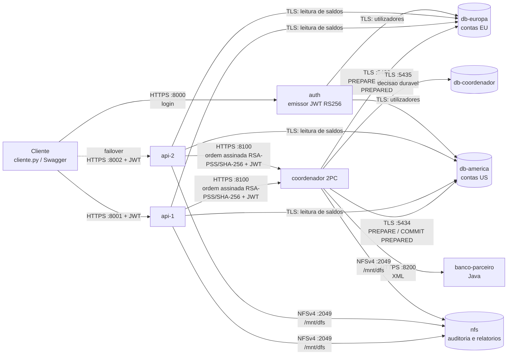
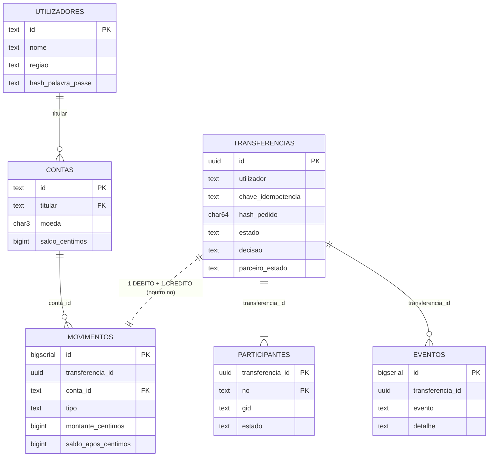

# Arquitectura do Global-Scale System

## Nos e ligacoes



| Ligacao | Protocolo | Seguranca | Para que serve |
|---|---|---|---|
| cliente → auth | HTTPS (REST/JSON) | TLS; palavra-passe com scrypt no servidor | Obter o JWT |
| cliente → api-1 / api-2 | HTTPS (REST/JSON) | TLS; JWT RS256 validado localmente | Contas, saldos, transferencias |
| api → coordenador | HTTPS (JSON) | TLS; ordem assinada pela instancia; JWT do utilizador | Pedir a transferencia |
| coordenador → db-europa / db-america | PostgreSQL | TLS `verify-full`; SCRAM-SHA-256; papel `gs_transaccoes` | Fases do 2PC |
| coordenador → db-coordenador | PostgreSQL | TLS `verify-full`; papel `gs_coordenador` | Registo das decisoes |
| api / auth → db-europa / db-america | PostgreSQL | TLS `verify-full`; papel `gs_leitura` (so SELECT) | Leituras |
| coordenador → banco-parceiro | HTTPS (XML) | TLS com a CA do laboratorio | Confirmacao das transferencias |
| api → banco-parceiro | HTTPS (XML) | TLS | Consulta de uma transferencia no parceiro |
| api, coordenador → nfs | NFSv4 (montado pelo Docker) | rede interna; ver limites no relatorio | Auditoria e relatorios |

## Redes, nomes DNS e portas (execucao local)

| Contentor | Rede `frontal` 172.30.1.0/24 | Rede `interna` 172.30.2.0/24 | Porta | Publicada no anfitriao |
|---|---|---|---|---|
| auth | 172.30.1.10 | 172.30.2.50 | 8000 | `8000` |
| api-1 | 172.30.1.11 | 172.30.2.51 | 8001 | `8001` |
| api-2 | 172.30.1.12 | 172.30.2.52 | 8002 | `8002` |
| db-europa | | 172.30.2.10 | 5433 | nao |
| db-america | | 172.30.2.11 | 5434 | nao |
| db-coordenador | | 172.30.2.12 | 5435 | nao |
| coordenador | | 172.30.2.20 | 8100 | `127.0.0.1:8100` (testes) |
| banco-parceiro | | 172.30.2.30 | 8200 | `127.0.0.1:8200` (testes) |
| nfs | | 172.30.2.40 | 2049 | nao |

A rede `frontal` so tem os servicos que os clientes usam. As bases de dados, o coordenador, o
banco parceiro e o NFS so estao na rede `interna`. Cada servico encontra os outros pelo nome, atraves
do DNS interno do Docker (`db-europa`, `coordenador`, ...). Os certificados TLS tem esses nomes no
SAN, por isso o cliente verifica que fala com o servidor certo. Cada no PostgreSQL usa uma porta
diferente (5433, 5434, 5435) para que a mesma configuracao funcione quando os nos estao em dois
computadores.

Em dois computadores, os nomes do outro PC sao resolvidos por `extra_hosts` (ficheiro hosts dos
contentores). Ver [DOIS_COMPUTADORES.md](DOIS_COMPUTADORES.md).

## Volumes persistentes

| Volume | Montado em | Conteudo |
|---|---|---|
| `dados-europa`, `dados-america` | db-europa, db-america | Dados e transaccoes preparadas (`pg_twophase/`) de cada fragmento |
| `dados-coordenador` | db-coordenador | Registo das transferencias e das decisoes 2PC |
| `nfs-exportacao` | nfs | Disco do servidor NFS (`/exports/dfs`) |
| `dfs` (tipo NFS) | api-1, api-2, coordenador em `/mnt/dfs` | O mesmo conteudo, visto pela rede |
| `espera-api-1`, `espera-api-2`, `espera-coordenador` | `/var/spool/gs-auditoria` | Eventos de auditoria ainda nao publicados no DFS |
| `dados-parceiro` | banco-parceiro em `/dados` | Registos do banco parceiro |

## Modelo de dados



**Nos regionais** (`db-europa`, `db-america`): o mesmo esquema
([bd/regional/01-esquema.sql](../bd/regional/01-esquema.sql)). A fragmentacao e horizontal: cada no
so aceita as linhas da sua regiao (restricoes `fragmento_europa` e `fragmento_america`). A regra de
encaminhamento e o prefixo da conta: `EU-` → db-europa, `US-` → db-america
([servicos/comum/config.py](../servicos/comum/config.py)).

| Restricao | Garante |
|---|---|
| `CHECK (saldo_centimos >= 0)` | Nunca ha saldo negativo, mesmo com um erro no codigo |
| `UNIQUE (transferencia_id, tipo)` em `movimentos` | No maximo um debito e um credito por transferencia em cada no |
| `CHECK (id LIKE 'EU-%')` / `'US-%'` | Cada fragmento so tem as suas contas |
| `montante_centimos BIGINT` | Valores exactos em centimos (sem virgula flutuante) |

**Base do coordenador** (`db-coordenador`, [bd/coordenador/01-esquema.sql](../bd/coordenador/01-esquema.sql)):

| Tabela | Conteudo |
|---|---|
| `transferencias` | Um registo por transferencia: dados, estado, **decisao global**, chave de idempotencia (`UNIQUE (utilizador, chave_idempotencia)`), resumo SHA-256 do pedido, estado da confirmacao no banco parceiro |
| `participantes` | Estado de cada no na transferencia: `POR_PREPARAR`, `PREPARADO`, `NAO_PREPARADO`, `INCERTO`, `CONFIRMADO`, `DESFEITO`, e o `gid` da transaccao preparada |
| `eventos` | Diario do protocolo (INICIADA, PREPARADO, DECISAO_COMMIT, CONFIRMADO, ...) |

O controlo do lado dos participantes e o proprio PostgreSQL: `pg_prepared_xacts` lista as
transaccoes preparadas e os seus `gid` (`gs-<id>-europa`, `gs-<id>-america`).

## Fluxo de uma transferencia (2PC)

```mermaid
sequenceDiagram
    participant API as api-1
    participant CO as coordenador
    participant LOG as db-coordenador
    participant EU as db-europa
    participant US as db-america
    API->>CO: ordem assinada (RSA-PSS/SHA-256) + JWT
    CO->>CO: verificar assinatura, janela temporal, JWT
    CO->>LOG: INSERT transferencia INICIADA (chave de idempotencia UNIQUE)
    Note over CO,US: Fase 1 - preparacao, um no de cada vez pela ordem fixa europa, america
    CO->>EU: BEGIN; UPDATE debito (saldo >= m); INSERT movimento; PREPARE TRANSACTION 'gs-id-europa'
    EU-->>CO: voto SIM (ou NAO: saldo insuficiente, conta inexistente, timeout)
    CO->>US: BEGIN; UPDATE credito; INSERT movimento; PREPARE TRANSACTION 'gs-id-america'
    US-->>CO: voto SIM
    CO->>LOG: UPDATE decisao = COMMIT (duravel, antes de comunicar)
    par Fase 2 - confirmacao em paralelo (asyncio.gather)
        CO->>EU: COMMIT PREPARED 'gs-id-europa'
        CO->>US: COMMIT PREPARED 'gs-id-america'
    end
    CO->>LOG: estado CONCLUIDA
    CO-->>API: 201 CONCLUIDA
    CO->>CO: confirmar ao banco parceiro (XML), em segundo plano
```

A ordem fixa da fase 1 evita bloqueios mutuos distribuidos: todas as transferencias bloqueiam
primeiro as linhas do Europa e so depois as do America, por isso nunca ha duas transferencias cada
uma a espera de uma linha que a outra tem noutro no. (Com as duas preparacoes em paralelo, o teste
de concorrencia mostrou 8 de 10 transferencias abortadas por `lock_timeout`.)

Se um no votar NAO (saldo insuficiente, conta inexistente) ou nao responder na fase 1, a decisao
gravada e ABORT e os nos que prepararam fazem `ROLLBACK PREPARED`. Se um no nao responder na fase 2,
a decisao COMMIT mantem-se e o ciclo de recuperacao repete `COMMIT PREPARED` ate ele voltar.
